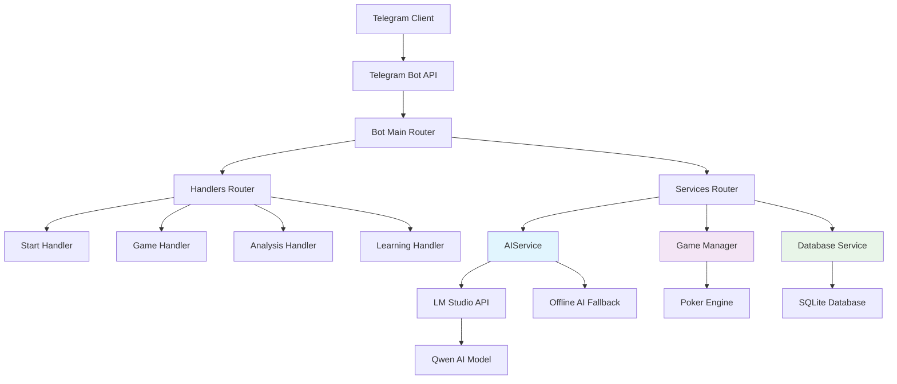
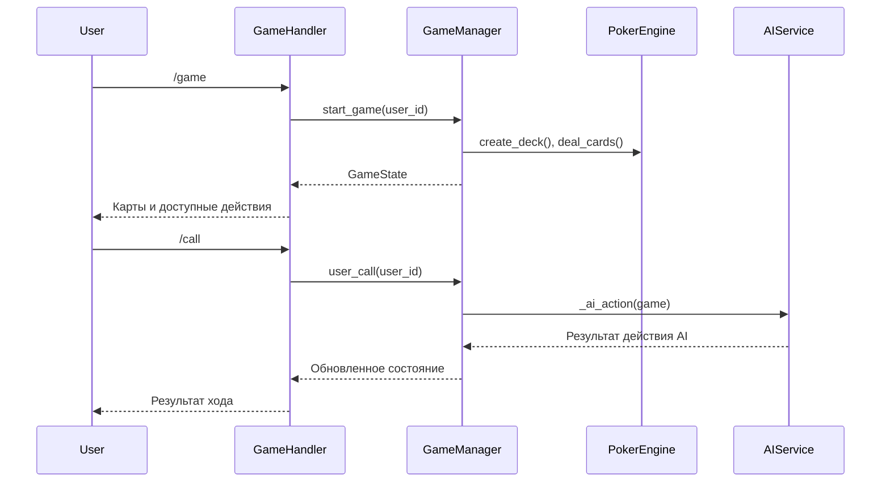
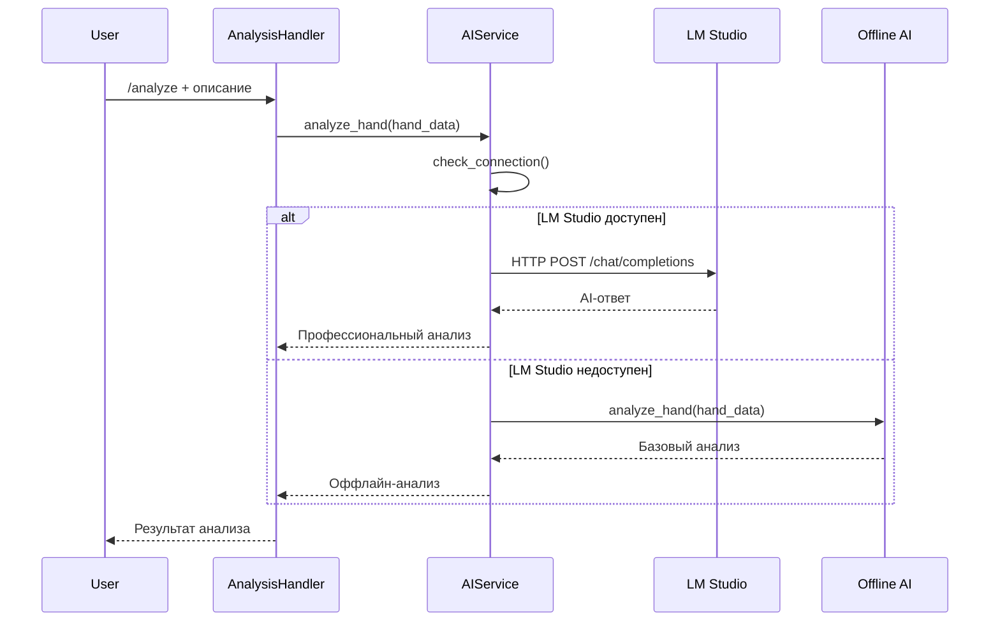

# План архитектуры

## 1. Общая архитектура системы

Poker Mentor построен по модульной микросервисной архитектуре с четким разделением ответственности между компонентами.



## 2. Компоненты системы

### 2.1. Core Components

#### **🤖 Bot Core (`main.py`)**
- **Назначение**: Точка входа, инициализация и координация всех компонентов
- **Технологии**: Aiogram 3.x, asyncio
- **Ответственность**:
  - Инициализация бота и диспетчера
  - Регистрация всех роутеров
  - Управление жизненным циклом приложения

#### **🎮 Game Manager (`game_manager.py`)**
- **Назначение**: Управление игровыми сессиями и состоянием
- **Ключевые классы**: `GameManager`, `GameState`
- **Ответственность**:
  - Создание и завершение игровых сессий
  - Управление игровым состоянием (стек, банк, улицы)
  - Координация действий игрока и AI

#### **🃏 Poker Engine (`poker_engine.py`)**
- **Назначение**: Логика покерной игры
- **Ключевые функции**:
  - Создание и перемешивание колоды
  - Раздача карт (префлоп, флоп, терн, ривер)
  - Форматирование карт для отображения

### 2.2. AI Components

#### **🧠 AI Service (`ai_service.py`)**
- **Назначение**: Управление взаимодействием с AI-моделью
- **Архитектура**: Фасад-паттерн для единого интерфейса
- **Функциональность**:
  - Проверка доступности LM Studio
  - Отправка запросов к AI-модели
  - Автоматическое переключение на оффлайн-режим

#### **📡 LLM Client (`llm_client.py`)**
- **Назначение**: Низкоуровневое взаимодействие с LM Studio API
- **Протокол**: HTTP REST API совместимый с OpenAI
- **Особенности**: Таймауты, обработка ошибок, повторные попытки

#### **🔄 Offline AI (`offline_ai.py`)**
- **Назначение**: Резервная система при недоступности основного AI
- **Реализация**: База предопределенных советов и анализа
- **Стратегия**: Случайный выбор из релевантных ответов

### 2.3. Data Components

#### **💾 Database Service (`database.py`)**
- **Назначение**: Управление персистентными данными
- **ORM**: SQLAlchemy с декларативными моделями
- **Модели**:
  - `User`: данные пользователей Telegram
  - `HandHistory`: история раздач для анализа

#### **👤 User Models (`user.py`)**
- **Назначение**: Определение структуры данных
- **Особенности**: Автоматические временные метки, отношения

### 2.4. Handler Components

#### **🚀 Command Handlers**
- **`start.py`**: Приветствие, регистрация, основное меню
- **`game.py`**: Управление игровым процессом
- **`analysis.py`**: Обработка AI-запросов на анализ
- **`learning.py`**: Образовательный функционал
- **`system.py`**: Системные команды и диагностика

## 3. Взаимодействие компонентов

### 3.1. Последовательность игры



### 3.2. AI-анализ раздачи



## 4. Потоки данных

### 4.1. Игровые данные
```
User Input → Telegram API → Handler → GameManager → 
PokerEngine → GameState → Response Formatter → User
```

### 4.2. AI-запросы  
```
User Question → Handler → AIService → LM Studio API →
Qwen Model → Response Parser → User
```

### 4.3. Данные пользователей
```
User Activity → Handler → Database Service → 
SQLite → User Model → Statistics
```

## 5. Масштабируемость и расширяемость

### 5.1. Горизонтальное масштабирование
- Stateless дизайн обработчиков
- Внешнее хранилище сессий (Redis готово к интеграции)
- Балансировка нагрузки между инстансами бота

### 5.2. Расширение функциональности
- Модульная система обработчиков
- Плагинная архитектура AI-провайдеров
- Легкое добавление новых игровых режимов

---

*Документация подготовлена: Шелков Данила (@dedyretti)*
